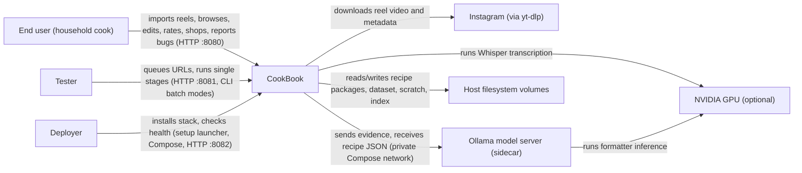
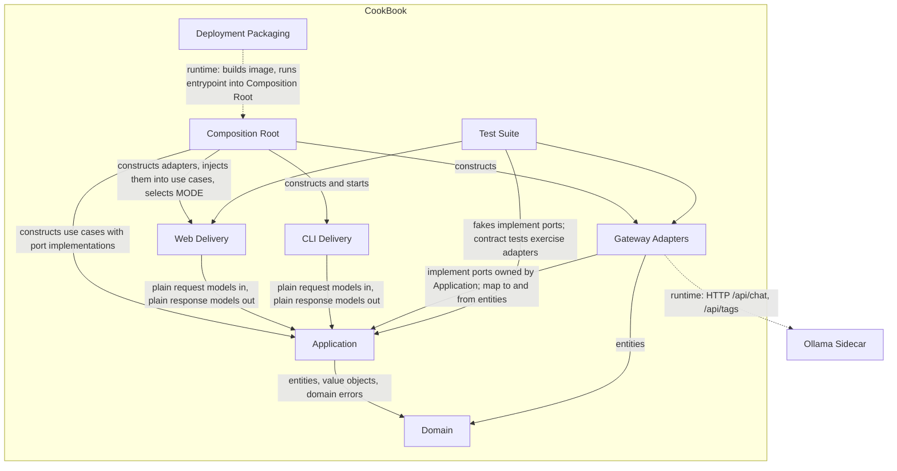

# Architecture

You fill this file. It is stage 2 of the workflow in `README.md`.

This file gives the general shape of the system: who it talks to, the main parts, the stack, and the decisions not left to the agent. The shape follows Clean Architecture. Policy (Domain, Application) sits at the center and owns its interfaces (ports). Every volatile detail (yt-dlp, ffmpeg, Whisper, Tesseract, Ollama, SQLite, the filesystem, FastAPI, the CLI, environment variables) is an outer adapter that implements or calls those ports. Source dependencies point inward only.

## Required: Context

## Required: Containers

Arrows are source-code dependencies (who imports whom), except the two runtime arrows marked *runtime*. No arrow points outward from Domain or Application.

## Required: Parts

Every part in the container diagram appears here. The agent must not add a part that is not in this list.

- **Domain**: Enterprise rules with no I/O. It holds the entities and value objects `Recipe`, `Ingredient`, `Instruction`, `Slug`, `ImportJob` (with its status lifecycle), `ImportOptions`, `EvidenceBundle`, `Transcript`/`TranscriptSegment`, `VisionEvidence`, `VideoMetadata`, `ManifestEntry`, `Rating`, `UserNote`, `ShoppingList`/`ShoppingListItem`, `Aisle` with keyword aisle classification, `BugReport`, and `DebugLog`/`LogEntry`. It enforces every invariant in SRS-FR-006, SRS-FR-008, SRS-FR-009, SRS-FR-018, SRS-FR-019, SRS-FR-020, SRS-FR-021, and SRS-FR-023 inside constructors and methods, and raises typed domain errors that name the failing field. Shopping-list merge and slug derivation and suffixing are domain behavior. It depends on nothing outside the Python standard library (no Pydantic, no I/O, no clock reads; time is passed in).
- **Application**: Use cases, one per user action, organized by capability, plus the ports they need.
  - Capabilities:
    - *import recipe*: the nine pipeline stage objects, the `StageRunner` (`run_all`, `run_step`, `run_from`, prerequisite checks, GPU gate acquisition), and the `ImportRecipe` use case.
    - *library*: `SearchRecipes`, `ViewRecipe`, `EditRecipe`, `RateRecipe`, `AddNote`, `RebuildIndex`.
    - *shopping*: `BuildShoppingList`.
    - *dataset*: `QueueUrls`, `BatchDownload`, `BatchTranscribe`.
    - *bug report*: `SubmitBugReport`.
    - *operations*: `CheckHealth`.
  - Ports it owns (abstract protocols):
    - media: `VideoDownloader`, `AudioExtractor`, `FrameExtractor`
    - recognition: `Transcriber`, `TextRecognizer`
    - formatting: `RecipeFormatter`, `RecipeRenderer`
    - persistence: `RecipeRepository`, `SearchIndex`, `DatasetStore`, `JobWorkspace`, `BugReportStore`, `DebugLogSink`
    - runtime: `GpuGate`, `Clock`, `IdGenerator`
    - health: `HealthProbe`
  - Use cases accept and return plain dataclass request and response models. They decide retry limits (SRS-FR-007), stage skipping (SRS-FR-003), failure recording (SRS-FR-004), write-then-index with restore (SRS-FR-012), and error-message content (SRS-FR-041).
- **Gateway Adapters**: Outbound details that implement Application ports.
  - Media and recognition: yt-dlp downloader, ffmpeg audio and frame extractors, faster-whisper transcriber, Tesseract recognizer.
  - Formatting: Ollama HTTP formatter (httpx; Pydantic DTO for parsing JSON output; prompt template), mock formatter, Markdown renderer.
  - Persistence: filesystem recipe repository (package layout, JSON mappers), SQLite search index, JSON dataset store and manifest, filesystem job workspace and debug-log sink, JSON bug-report store.
  - Runtime and health: process-wide GPU gate (lock), system clock, UUID generator, system health probe (`docker`/`ffmpeg` on PATH, Ollama `/api/tags`, CUDA availability).
  - Adapters translate formats and vendor errors into domain or application errors. They contain no business branching.
- **Web Delivery**: Three humble FastAPI + Jinja2 apps, one per audience: Production (:8080), Testing (:8081), and Deployment (:8082). Each has controllers that parse form and query input into request models, call one use case, and pass the response model to a presenter or view model and template. Controllers map domain and application errors to HTTP status and dismissible messages. They never touch adapters, files, or SQL directly.
- **CLI Delivery**: Humble command handlers for `import <url>`, batch `download`, batch `transcribe`, and single `run-step`. Each parses arguments into request models, calls the same use cases as Web Delivery, prints the result, and sets the exit code.
- **Composition Root**: The only place that reads environment variables and `.env` (pydantic-settings), validates and caps configuration (SRS-FR-040), runs startup checks and folder creation (SRS-FR-039), constructs every adapter, injects adapters into use cases, and dispatches on `MODE` to exactly one delivery entry point.
- **Test Suite**: pytest tests and reusable in-memory fakes, one per port. Domain and use-case tests use fakes only. Adapter contract tests run at the seams with recorded fixtures or subprocess mocks. Delivery tests use FastAPI's test client against fakes. The acceptance tests are the SRS scenarios, and an architecture test enforces the dependency rule.
- **Deployment Packaging**: Dockerfile, Compose files (base, GPU override, test), the container entrypoint, the Ollama bootstrap script that registers `cookbook-formatter`, the formatter Modelfile, `.env.example`, and the Windows setup and CLI launchers.
- **Ollama Sidecar**: The `ollama/ollama` container, unmodified. It is configured with `OLLAMA_MAX_LOADED_MODELS=1`, it is not published to the host, and it is reached only by the Ollama formatter adapter and the health probe.

## Required: Stack

- **Language/runtime**: Python 3.12.
- **Packaging/build**: `pyproject.toml` with setuptools, `src/` layout, distribution `cookbook`, console script `cookbook`, and editable install `pip install -e ".[dev]"`.
- **Domain/Application**: Python standard library only (`dataclasses`, `typing.Protocol`, `enum`, `abc`, `re`, `datetime` as a value type).
- **Web**: FastAPI, Jinja2, uvicorn, python-multipart.
- **Validation at the edges**: Pydantic 2 (formatter output DTOs, JSON mappers) and pydantic-settings (configuration), used only in adapters and the Composition Root.
- **HTTP client**: httpx (Ollama).
- **Media and ML**: yt-dlp, ffmpeg (system binary), faster-whisper with PyAV pinned `av>=12,<19`, CUDA 12 runtime wheels (`nvidia-cublas-cu12`, `nvidia-cudnn-cu12`) for GPU, pytesseract with the Tesseract binary, and Pillow.
- **Persistence**: filesystem (JSON, Markdown, text, mp4) and `sqlite3` from the standard library.
- **Tests**: pytest.
- **Deployment**: Docker (`python:3.12-slim` base) and Docker Compose v2 with an `ollama/ollama` sidecar.

## Required: Hard constraints

- **Dependency rule**: modules under Domain and Application must not import FastAPI, Starlette, Jinja2, Pydantic, httpx, `sqlite3`, `subprocess`, `os.environ`/`dotenv`, `pathlib`-based file I/O, yt-dlp, faster-whisper, pytesseract, PIL, or any Gateway Adapter, Web Delivery, CLI Delivery, or Composition Root module. Domain must not import Application. An automated architecture test in the Test Suite enforces this (SRS-NFR-006), and the build fails if it fails.
- **Port ownership**: ports are defined in Application and implemented in Gateway Adapters. A use case never constructs an adapter. Only the Composition Root wires concrete classes.
- **Humble edges**: controllers, CLI handlers, presenters, and adapters hold no business validation or branching. Validation rules live in Domain entities, and orchestration and policy live in use cases.
- **Plain boundary models**: use cases take and return plain dataclasses. They never receive FastAPI `Request` objects, Pydantic models, SQLite rows, or file handles.
- **Shared pipeline**: there is one implementation of each pipeline stage. Production import, CLI import, CLI batch modes, and the Testing UI all reach stages only through Application use cases and the `StageRunner`. No stage calls another stage.
- **Isolated evidence**: Stage 7 (format) receives evidence as a value object and has no write access to transcript artifacts. Stages 8 and 9 have no `RecipeFormatter` dependency (SRS-FR-011, SRS-NFR-009).
- **GPU stages**: stages that declare `needs_gpu` (3 transcribe, 7 format) run only while holding the `GpuGate`. The Whisper adapter releases its model before the gate is released (SRS-NFR-002).
- **Package first**: the filesystem recipe package is the source of truth, and SQLite is a derived index that `RebuildIndex` can recreate (SRS-FR-012, SRS-FR-013).
- **Offline tests**: tests never call Instagram, load Whisper weights, or contact a live Ollama server (SRS-NFR-005).
- **No secrets in output**: no secret or `.env` file is committed, and no secret value appears in rendered HTML (SRS-NFR-008, SRS-FR-035).
- **Python only**: no Java, no cloud LLM SDKs, and no cloud speech services.

## Required: Decisions

### Decision 1

- **Context**: In `cursor1/`, Pydantic models served as entities, pipeline steps imported concrete providers and file paths, and web routes read storage and SQLite directly. Changing a model provider, the storage layout, or the web framework touched business code, and tests needed the real filesystem layout to check rules such as slug reuse or step numbering.
- **Decision**: Rebuild with Clean Architecture layers organized by capability. Domain is a pure standard-library core that owns every invariant. Application holds one use case per action plus the ports it owns. Gateway Adapters, Web Delivery, and CLI Delivery are humble outer rings, and the Composition Root is the single wiring point. Pydantic stays at the edge, both to validate untrusted JSON (formatter output, `recipe.json` on disk) and to map it into domain entities. The rule is enforced by an architecture test.
- **Rejected**: Porting the `cursor1/app/` technical-bucket layout (`steps/`, `storage/`, `search/` …) with Pydantic entities. That is shorter now, but frameworks stay inside policy and the boundary has no enforcement. A hexagonal split into separate installable packages was also rejected, because one package with an enforced import rule gives the same protection at lower cost.
- **SRS IDs**: SRS-NFR-006, SRS-NFR-007, SRS-NFR-005, SRS-FR-009

### Decision 2

- **Context**: The nine-stage import must be runnable whole (production UI, CLI), one stage at a time (Testing UI), and resumed from a stage. On an 8 GB GPU, Whisper and the formatter must never overlap.
- **Decision**: Each stage is an Application object implementing a `PipelineStage` protocol: `number`, `name`, `requires` (artifact keys), `needs_gpu`, and `run(StageContext) -> StageResult`. Stages depend only on ports. A `StageRunner` use case owns ordering, prerequisite checks (SRS-FR-034), skip rules (SRS-FR-003), the bounded formatter retry (SRS-FR-007), debug-log entries (SRS-FR-024), failure recording (SRS-FR-004), and acquiring the `GpuGate` port for `needs_gpu` stages. `ImportRecipe` builds the job and context and delegates to `StageRunner.run_all`. The Testing UI and CLI call `run_step` and `run_from`.
- **Rejected**: A single monolithic pipeline function. It cannot run one stage alone or be tested per stage. Stages calling each other was rejected because it hides ordering and breaks single-step runs. A GPU lock inside the Whisper and Ollama adapters was rejected because it spreads a policy rule into details and cannot cover both models.
- **SRS IDs**: SRS-FR-002, SRS-FR-003, SRS-FR-004, SRS-FR-007, SRS-FR-033, SRS-FR-034, SRS-FR-038, SRS-NFR-002

### Decision 3

- **Context**: The recipe package on disk must stay authoritative. Every write must leave the index consistent, re-imports must reuse a slug, and a failed import must never damage an existing package.
- **Decision**: The `RecipeRepository` port (filesystem adapter) is the system of record, and `SearchIndex` (SQLite adapter) is a projection. Every write goes through one Application policy in this order: stage the new package files in the job workspace, then replace the package, then upsert the index. If the upsert fails, restore the previous package from the staged backup and surface the error. The use case does slug resolution by asking the repository for an existing slug with the same source URL, and the domain `Slug` value object handles derivation and suffixing. `RebuildIndex` regenerates the projection from packages.
- **Rejected**: SQLite as the primary store with files as exports. That makes the filesystem a cache, loses the browsable package, and breaks the evidence-folder promise. Writing the index before the package was rejected because a crash would leave index rows for packages that don't exist.
- **SRS IDs**: SRS-FR-004, SRS-FR-005, SRS-FR-006, SRS-FR-012, SRS-FR-013, SRS-FR-017

## Required: Primary design rule

`clean-architecture.mini.md`
